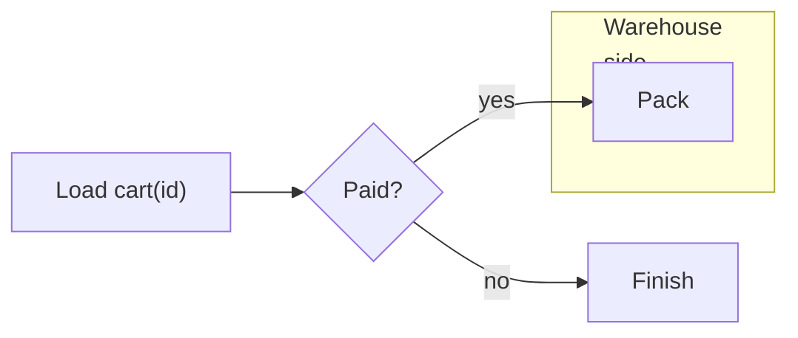
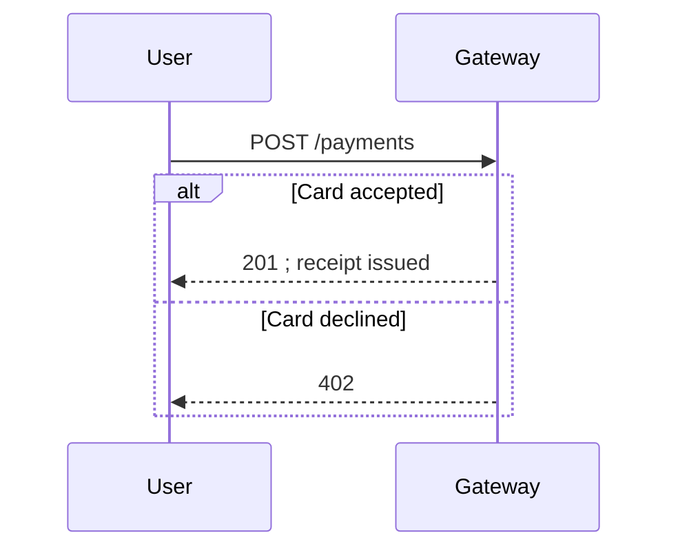
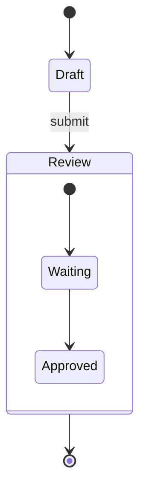

---
paths:
  - "**/*.mmd"
---

# Mermaid Without Parse Errors

Most broken Mermaid diagrams fail for the same few reasons. Read this before putting one in
a pull request, a review comment, a spec or a wiki page. The path scope above is nominal:
diagrams usually live inside Markdown, which never triggers it, so whoever draws one should
open this rule on purpose.

## Ground rules

- Draw only sequence diagrams, flowcharts and state diagrams, opened by `sequenceDiagram`,
  `flowchart` or `stateDiagram-v2`. The older `stateDiagram` header is not used.
- Prefer syntax that has been around for years. GitHub ships its own Mermaid build, often
  behind the newest release, so a recent feature may render in the editor and fail there.
- The diagram goes in a code fence tagged exactly `mermaid`.

## Symptom, cause, fix

| You see | Cause | Fix |
|---|---|---|
| A flowchart node cut short, or the parse stops | A label holds `()`, `[]`, `{}`, a semicolon or a double quote, unquoted | Quote the whole label: `A["Call save(order)"]` |
| A label containing a quote fails | Backslash does not escape quotes here | Write the inner quote as `#quot;` |
| Everything after some point is garbage | A `"` opened on a line is never closed on it | Close each quote before the line ends |
| Text on an arrow is ignored | The edge text is not between pipes | `A -->\|on retry\| B` |
| A subgraph title breaks | It holds markup, brackets or a line break | Give the subgraph an id and quote the title: `subgraph core["Core<br/>services"]` |
| The diagram ends early | A lowercase `end` was used as a node id, participant or subgraph name | Use `End` or `finish`; lowercase `end` is fine inside a quoted label |
| A flowchart arrow becomes a circle or a cross | An id starting with `o` or `x` touches the link (`A---oB`, `A--xRay`) | Separate the id from the link with a space, or give it a capital |
| The rest of a sequence line is a syntax error | A semicolon inside a message or note ends the statement | Write `#59;` (a semicolon at the very end is harmless) |
| The whole diagram will not parse | A comment was written with `//` or `#` | Comments are `%%`, alone at the start of a line |
| Parsing fails when front matter is present | Something, even a blank line, sits above the `---` block | Front matter starts on line one; an `%%{init: ...}%%` directive goes before the type line |
| A block never closes | An `alt`, `opt`, `loop`, `par`, `critical`, `break`, `rect`, `box` or `subgraph` has no `end`, or a `state X {` has no `}` | Close each one; `else` pairs with `alt`, `and` with `par`, `option` with `critical` |

Two details that surprise people: in a *sequence* diagram `-x` and `--x` are real arrows
(a lost message), so the circle-and-cross trap above is a flowchart-only problem; and a
bare `#12` is plain text, while `#59;` or `#quot;` is read as an entity code.

When a participant's name is long, declare it once with an alias
(`participant G as payment-gateway`) and use the short id in the messages.

## Checking before you publish

- With a Mermaid linter or the live editor at hand, run the diagram through it. If it still
  fails after a fix, leave the diagram out rather than post it broken.
- A clean linter run is a heuristic and does not prove GitHub will render it. Say no more
  than that.
- With no tool, check by eye: the fence tag, the first line naming the diagram type, front
  matter placement, `%%` comments, no stray lowercase `end`, balanced quotes, quoted labels
  with brackets, `#59;` for semicolons in sequence messages, and every opened block closed.
  Then say in your output that the syntax was checked by hand.

## Minimal skeletons







What breaks, shown as plain text so that no renderer treats it as a diagram:

```text
flowchart LR
    Read[Load cart(id)] --> end         %% unquoted parentheses, and `end` as a node name
    A---oB                               // `//` starts no comment, and `oB` makes a circle edge
sequenceDiagram
    U->>G: charge; then confirm          %% the semicolon ends the statement
```
